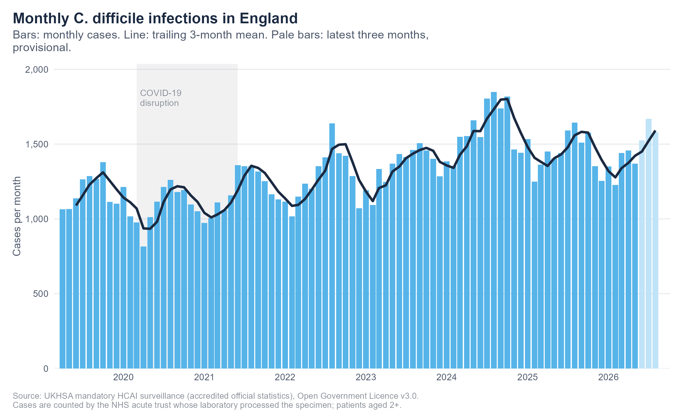
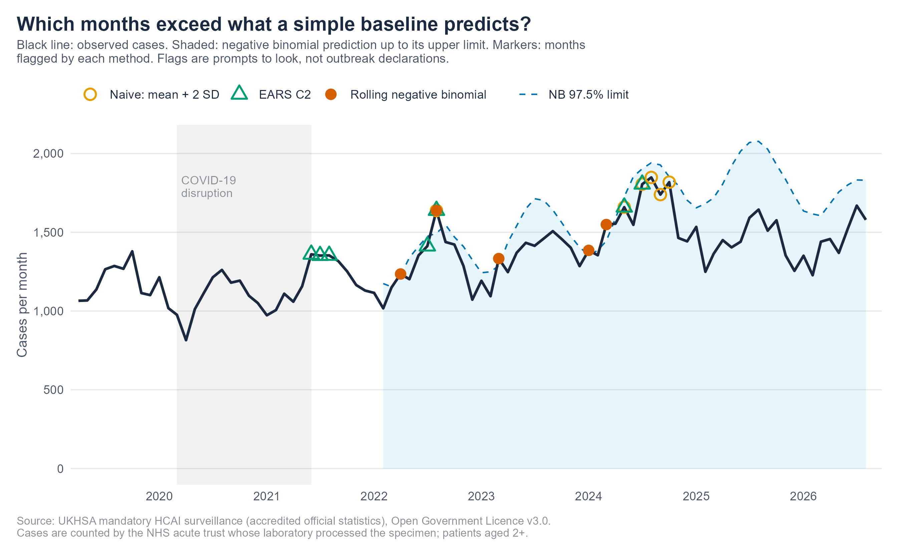
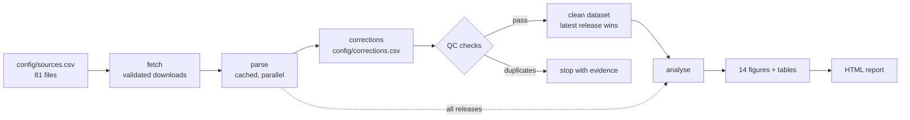

# C. difficile infection surveillance in England

[](https://github.com/paytonyau/cdiff-surveillance/actions/workflows/ci.yml)


A reproducible pipeline and report for **descriptive surveillance of *Clostridioides difficile* infection (CDI)** using the UK Health Security Agency's monthly mandatory surveillance counts for NHS acute trusts in England (April 2019 to date).

It turns **81 overlapping spreadsheets in several layouts** into one quality-checked dataset, then describes trends over time, by onset category, by season, by region and by trust, flags unusual months with three simple methods, and measures **how much published counts are revised after release**.

> **Scope.** This is a worked surveillance exercise on public aggregated data. It is not operational surveillance, it does not rank trusts, and an exceedance flag is a prompt to look, not an outbreak declaration. See [Limitations](#limitations).

## Questions

1. How have monthly CDI counts in England changed since April 2019, including through COVID-19?
2. Where does infection start (hospital-onset vs community-onset categories), and is there a seasonal pattern?
3. How do regions and trusts compare *with their own pre-COVID baseline*?
4. Which months exceed what simple baselines predict, and do the methods agree?
5. How reliable are the most recent (provisional) months? How much do counts change after first publication?

## Quick start

```r
# 1. install packages once (or use renv: see docs/design-decisions.md)
install.packages(c("data.table", "dplyr", "ggplot2", "ggrepel", "knitr", "lubridate", "MASS", "patchwork",
                   "purrr", "ragg", "readODS", "readr", "readxl", "rmarkdown", "scales", "slider",
                   "stringr", "tibble", "tidyr", "yaml", "testthat", "withr"))
```

```bash
Rscript run.R --demo      # preview the whole report on SYNTHETIC data (no downloads), written to outputs/demo/
Rscript run.R             # real data: fetch -> build -> analyse -> outputs/report.html
Rscript run.R --workers=4 # parallel downloads and parsing
make test                 # 130+ tests
```

The first real run downloads and parses 81 files; later runs reuse the hash-keyed cache and take seconds. Add a new monthly release by appending one row to `config/sources.csv`.

## Outputs

After `Rscript run.R` (commit these so the repository shows its results):

| | |
|---|---|
| `outputs/report.html` | The full report |
| `outputs/figures/` | 14 figures (`01_overview.png` ... `14_revision_national.png`) |
| `outputs/tables/` | CSV copy of every table in the report |
| `data/derived/cdiff_england_clean.csv.gz` | The cleaned analysis dataset ([dictionary](docs/data-dictionary.md)) |
| `data/derived/qc/` | Quality-check results, layout report, applied corrections |

<p>


</p>

## How it works



Key rules (reasons in [docs/design-decisions.md](docs/design-decisions.md)):

- **One geography.** The same cases are published for trusts, sub-ICBs and England; only trusts are analysed, and a check confirms the three agree.
- **Latest release wins**, and earlier releases are kept so revisions can be measured.
- **Fail loudly.** An unknown metric label, organisation type or header row stops the build with the evidence.
- **Corrections are data.** Known source errors live in `config/corrections.csv` with a reason, and every applied correction is logged.
- **Compare units with themselves.** No denominator is published, so trusts and regions are indexed to their own baseline, never ranked on raw counts.

## Repository layout

```
run.R                  one command for the whole pipeline (--demo, --refresh, --workers, --dpi)
config/                params.yml, sources.csv (81 files), corrections.csv      -> config/README.md
R/                     function library: fetch, parse, clean, qc, analysis, plots, tables, pipeline, demo
scripts/               thin stage scripts: 01_fetch ... 04_report
reports/               report.Rmd + style.css
data/raw/              downloaded files + RETRIEVAL_LOG.csv (dates and MD5 checksums)
data/cache/            parsed-file cache (not committed)
data/derived/          cleaned dataset, organisation lookup, QC results
data/reference/        hand-checked lookups (trust mergers)
outputs/               figures, tables, report
tests/                 130+ tests with fixtures for old and new spreadsheet layouts
docs/                  data sources, data dictionary, methods, design decisions, roadmap, research notes
```

## Methods in brief

Trailing 3-month means; annual totals by NHS financial year; onset composition; seasonal index and robust STL decomposition; regional and trust indices against the April 2019 to February 2020 baseline with exact Poisson intervals; and three exceedance rules, each using only earlier months: **mean + 2 SD**, **EARS C2**, and a **rolling negative binomial** (trend + annual harmonic, COVID window excluded from training). Full detail in [docs/methods.md](docs/methods.md).

## Limitations

- **Counts, not rates**: no bed-day denominator is published. UKHSA itself states the data do not support comparisons between trusts.
- Cases are attributed to the **reporting laboratory's trust**, not necessarily where infection was acquired.
- **Trust mergers** change the set of trusts over time; regional and national series are more robust.
- **Recent months are provisional** and routinely revised; some trust-months are unsigned.
- The **COVID-19 window** (March 2020 to June 2021) is an analyst's choice and is configurable.
- **Exceedance rules are not yet validated** against known or simulated outbreaks (planned: see [roadmap](docs/roadmap.md)).
- Aggregated data only: no age, sex or individual-level inference.

## Roadmap

Rates and maps with bed-day and population denominators; validation of the exceedance methods using simulated outbreaks; real-time vs final exceedance using the revision archive; Scotland and the other UK nations; automatic discovery of new releases. See [docs/roadmap.md](docs/roadmap.md) and [docs/research-opportunities.md](docs/research-opportunities.md).

## Data, licence and citation

Data: UKHSA, *C. difficile infection: monthly data by prior trust exposure*, accredited official statistics, [Open Government Licence v3.0](https://www.nationalarchives.gov.uk/doc/open-government-licence/version/3/). Contains public sector information licensed under the Open Government Licence v3.0. Sources and layouts: [docs/data-sources.md](docs/data-sources.md).

Code: MIT ([LICENSE](LICENSE)). Please cite via [CITATION.cff](CITATION.cff) and cite the data to UKHSA.

Author: Payton Yau ([ORCID 0000-0002-3283-0370](https://orcid.org/0000-0002-3283-0370)).
